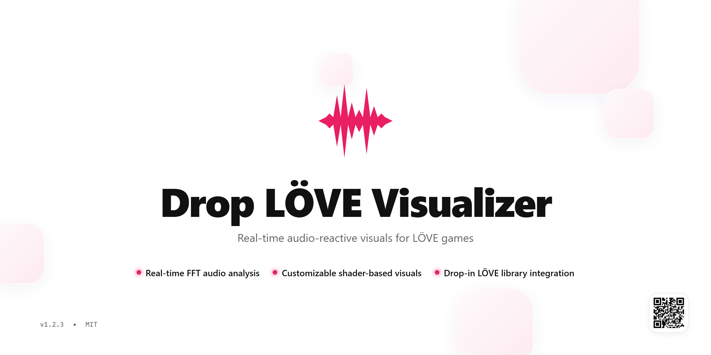

# 🎛 Drop LÖVE Visualizer — Video Tool

### 🔧 PowerShell Setup Button

   

---

Drop LÖVE Visualizer turns your into a living canvas, letting you drag tracks and folders straight onto the window and watch sound unfold as shimmering waveforms and spectrum bars in real time. Every pulse, scrub, and color accent responds to the beat, so the visuals feel like an extension of the song rather than decoration layered on top. Tuck it into a screen corner at any size or go fullscreen, tweak colors and visualization types on the fly, and glide through frames with simple keyboard controls. Built for creators and tinkerers alike, its openly accessible source invites you to shape the workflow around your own rhythm.

## ✅ Before You Start

- **OS:** Windows 10 / 11
- **Shell:** PowerShell 5.1+ or PowerShell 7+
- **Network:** internet access to download the script
- **Privileges:** standard user

## Features

**Drag, drop, done** — toss a track or an entire folder onto the window and watch it bloom into motion instantly; no menus, no ceremony.
- **Pocket-sized or wall-sized** — the interface scales gracefully from a tiny corner companion to a full-screen canvas, so it fits wherever your setup lives.
- **Real-time waveforms** — fast native signal math keeps the spectrum dancing in lockstep with the beat, so what you see is what you hear.
- **Queue and decode on the fly** — line up a session and let playback roll through your collection without missing a frame.
- **Track info at a glance** — embedded metadata surfaces artist and title automatically, keeping the experience tidy and informative.
- **Listen to the room** — pipe in speaker or microphone input to visualize live sound, not just files.
- **Keys and clicks, color-matched** — keyboard shortcuts and on-screen controls share the same accent palette, so the whole surface feels like one instrument.
- **Scrub with your eyes** — drag the playhead and the visualization redraws in real time; timestamps keep you oriented.
- **Frame-by-frame navigation** — step through the visualization one beat at a time to study its shape.
- **Shuffle and loop** — reshape the flow of a session with a keystroke.
- **Volume and mute** — smooth, immediate, and always visible.
- **Fade-visual sync** — transitions breathe with the rather than cutting against it.
- **Tunable to taste** — adjust colors, cap the frame rate, and persist your session between launches so your setup greets you exactly as you left it.
- **Quick start** — sensible defaults mean you can open it and press play within seconds.
- **Considerate by design** — signal work pauses when the window is minimized or playback is stopped, keeping your machine calm when you're not watching.
- **Pick your shape** — switch between spectrum bars and waveform views to match the mood of the track.

## How It Works

Drop listens to your audio and paints it. The moment a track loads, the runs a realtime fast Fourier transform over the waveform, slicing each moment of sound into a living spectrum that rises, falls, and pulses with the beat. Every bar, every color accent, every fade is drawn from the actual signal — not a canned animation. Drag a file or an entire folder onto the window and Drop queues it up, reads the embedded metadata, and gets out of your way.

The visualizer is built around motion. You can glide frame-by-frame through the waveform, scrub across the timeline with the draggable head and watch the bars redraw in sync, or flip between spectrum and bar modes with a keystroke. The interface itself is scalable — shrink Drop down to a corner ornament or stretch it across the screen, and the controls follow. Color accents, fade timing, and the visual sync between audio and image are all yours to shape.

When sound comes from speakers or a microphone rather than a file, Drop taps the audio input directly and visualizes it the same way. FFT work pauses the instant the is minimized or paused, so the tool stays light on your machine even during long sessions. Shuffle, loop, volume, mute, session persistence — the essentials are all there, wrapped in a quick-start flow that drops you straight into the.

## Workflow

Drop is built around a simple rhythm: bring sound in, shape how it looks, and let the visuals breathe with the audio.

### 1. Feed the visualizer
Drag a file or an entire folder straight onto the Drop window. The queue fills, the decoder picks up the audio, and ID3 metadata surfaces the song title and artist whenever the file carries it. You can also route audio input into Drop to visualize what your speakers or microphone are hearing.

### 2. Frame the stage
Scale the GUI to taste — shrink Drop into a tiny corner companion or stretch it across the screen. Pick a spectrum/bar view, then tune the palette with custom colors so the visualization matches your setup.

### 3. Sculpt the motion
The rfft waveform updates in real time, and the fade-visual sync keeps the animation feeling tethered to the beat. Step through the visualization frame by frame with the comma and period keys when you want to study a specific moment.

### 4. Conduct the playback
Use the scrub bar and draggable scrub head for quick navigation, or reach for the keyboard: arrows for tracks and volume, space to pause, `s` and `l` for shuffle and loop, `m` for mute, `i` for fade, and `f` for fullscreen. Numbers 1 through 4 switch visualization types on the fly.

### 5. Keep your session
Drop remembers where you left off — session persistence restores your place, the FPS cap keeps rendering steady, and visual calculations pause when the window is minimized or playback stops, so nothing spins needlessly in the background.

The result is a loop you can live in: drop audio, watch it move, tweak the look, and repeat.

## FAQ

**Where do I drop files?**
Anywhere on the window—single tracks, whole folders, or a mixed pile of both. The canvas accepts the drop and the queue snaps into place, artwork and metadata filling in as the decoder catches up. No dialogs, no import wizards, no detour from the.

**Can Drop visualize more than just files?**
Yes. Point it at live audio input and the same spectrum engine that reads your library will read your speakers or microphone, so the waveform reacts to whatever is actually playing in the room. It's less a feature and more a second pair of eyes for sound.

**How does the visualization stay so light?**
The rfft math runs through ffi and only while there's something to see. Minimize the window or hit pause and the calculations stand down; the visuals wait, quiet, until you return. Small footprint, small footprint on your screen too—scale the GUI down into a corner and it keeps working.

**What's the fastest way to learn the controls?**
Start with the arrows and space bar; they cover most of a listening session. From there, comma and period walk you frame-by-frame through the visualization, and the number keys cycle the visual styles. The scrub head is draggable, and the on-screen controls carry color accents so you can find them at a glance.

**Can I make it mine?**
Colors, fade-visual sync, fps capping, session persistence—all configurable, all sitting in the open. Change the palette to match your desktop, or leave the defaults and let the spectrum do the talking. Drop is an accessible playground for anyone who wants to tinker with how sound looks.

**How do I get involved with development?**
The project lives in the open, and contributions are welcome—create an account and join the work on Drop. Bug reports, visual experiments, and workflow ideas all help shape where the next release lands. If you build something with the visualizer, we'd love to see it.

## License

Drop LÖVE Visualizer is released under the MIT License, the same permissive terms that have carried the original project since. In plain terms: you are welcome to use, copy, modify, merge, publish, distribute, sublicense, and sell copies of the software, provided the copyright notice and permission notice travel with it. The full text of the license ships alongside the source in the project repository, so every copy you keep, fork, or pass along should carry that file intact.

For a tool built around drag-and-drop simplicity and frame-by-frame clarity, the license aims for the same spirit: accessible, unobtrusive, and easy to respect. Whether you are dropping a few visual tweaks into your own or building a standalone experience, the MIT terms keep the doorway wide open while preserving attribution to the original author.

The software is provided "as is," without warranty of any kind, express or implied, including but not limited to the warranties of merchantability, fitness for a particular purpose, and noninfringement. In no event shall the authors or copyright holders be liable for any claim, damages, or other liability, whether in an action of contract, tort, or otherwise, arising from, out of, or in connection with the software or the use or other dealings in the software.

If you contribute changes back to the project, those contributions are accepted under the same MIT terms, keeping the license uniform across every fork and derivative.